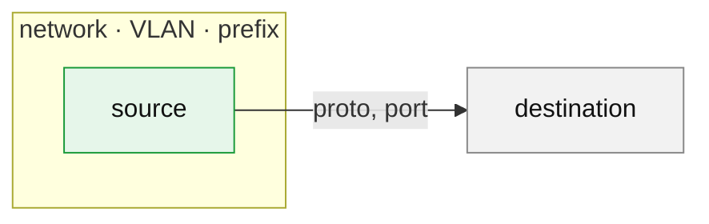

<!--
One sentence: what this change does and the record that asks for it (Issue, kb decision).
Put every other section in a 
 block. Keep a blank line after 
 and
before 
, or GitHub does not render the markdown inside.
Delete a section that does not apply. Do not leave it empty.
-->

Closes #

<!--
Network changes (networks, VLANs, zones, bridges, firewall or gateway rules, DNS paths):
draw the change as a Mermaid flowchart. GitHub renders it in place, and it needs no image
hosting, so it works in private repositories. Green = added, red dotted = blocked or
removed, grey = unchanged. Delete this section when the change does not touch the network.
-->

<b>Network diagram</b>

<b>Changes</b>

-

<b>Effect</b>

<!-- What changes in the rendered or running state: files, rules, resources added or removed. -->

-

<b>Apply order (after merge)</b>

1.

<b>Risks</b>

-

<b>Not in this PR</b>

-

<b>Verification</b>

<!-- Commands run and their result. Link CI runs. -->

-

